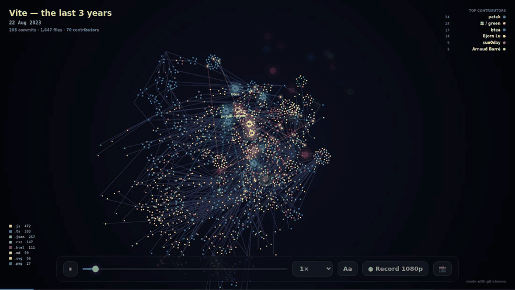

# 🎬 git-cinema

**Turn any git history into a film.**

One command reads your repository and writes a single HTML file: directories grow into a living tree, files light up when they're added, changed or deleted, and every contributor flies around the codebase firing at the files they touch. Hit **Record** and you get a 1080p MP4 to post.



**▶ Watch it live:** [Express, 17 years](https://cedricpoint.github.io/git-cinema/express.html) · [Vite, last 3 years](https://cedricpoint.github.io/git-cinema/vite.html)

## Quick start

```bash
git clone https://github.com/CedricPoint/git-cinema.git
node git-cinema/git-cinema.js path/to/your/repo --open
```

Requires Node.js 18+ and git. Zero dependencies, nothing to install.

```text
  🎬 express: 5,637 commits, 383 contributors, 903 files, 2009→2026
  → express-cinema.html (0.2 MB, 184 ms)
```

Or put it on your `PATH` with `cd git-cinema && npm link`, then run `git-cinema` in any repository.

## What you see

| | |
|---|---|
| 🌳 **The tree** | Every directory is a node, every file a dot colored by language, arranged around its folder. The layout is a live physics simulation, so the project visibly grows, splits and gets reorganised. |
| ✨ **The pulses** | Green flash for a new file, amber for a change, red for a deletion (the file then fades away). |
| ☄️ **The contributors** | Each author is a glowing comet that flies to the files of each commit and fires beams at them. |
| 📊 **The HUD** | Date, commit count, live files, top contributors and language breakdown, all drawn into the video. |

## The player

| Key | |
|---|---|
| `space` | play / pause |
| `←` `→` | seek |
| `+` `−` | speed (0.25× to 8×) |
| `L` | toggle labels |
| `S` | save a PNG snapshot |
| **● Record 1080p** | replays the film from the start and downloads it as **MP4** (H.264) where the browser supports it, WebM otherwise |

By default the whole history plays in about 80 seconds, and long quiet periods are skipped.

## Options

```text
git-cinema [repo] [options]

  -o, --out <file>      Output HTML file (default: <repo>-cinema.html)
  --since <when>        Only commits after this date, e.g. "2 years ago"
  --until <when>        Only commits before this date
  --max-commits <n>     Keep the most recent n commits (default: 30000)
  --title <text>        Title shown in the film (default: repository name)
  --exclude <glob>      Hide paths (repeatable), e.g. --exclude "docs/**"
  --anonymize           Replace author names with "Dev 1", "Dev 2", …
  --include-bots        Keep commits from bots (dependabot, renovate, …)
  --open                Open the film in your browser when done
```

## Good to know

- **Private code stays private.** The HTML contains file paths, author names and commit dates. Never file contents, emails or commit messages. Use `--anonymize` to drop names too, and `--exclude` to hide paths.
- **One person, several emails?** Authors are merged by name and by email, and `.mailmap` is respected.
- **Bots are skipped** by default, so Renovate doesn't steal the show.
- **Renames** play as the file leaving one folder and appearing in another.
- **Shallow clones** start with a big bang: everything that existed at the shallow boundary appears in the first frame.
- `node_modules`, `vendor`, `dist`, `build` and similar folders are hidden.

## How it works

1. `git log --reverse --name-status -M` is parsed into a compact timeline: a table of paths, a table of authors, and each commit stored as `[time, author, [path × 4 + kind]]`. Express's 17 years fit in 200 KB.
2. That timeline is embedded in `player.html`, a canvas renderer with a spring/repulsion layout (spatial hashing keeps it fast with thousands of directories), pre-rendered glow sprites and a percentile-based camera.
3. Recording uses `canvas.captureStream()` and `MediaRecorder` at a fixed 1920×1080, so the video doesn't depend on your window size.

## Credits

Inspired by the legendary [Gource](https://gource.io). git-cinema is an independent take that needs no install and runs in any browser.

## License

MIT
